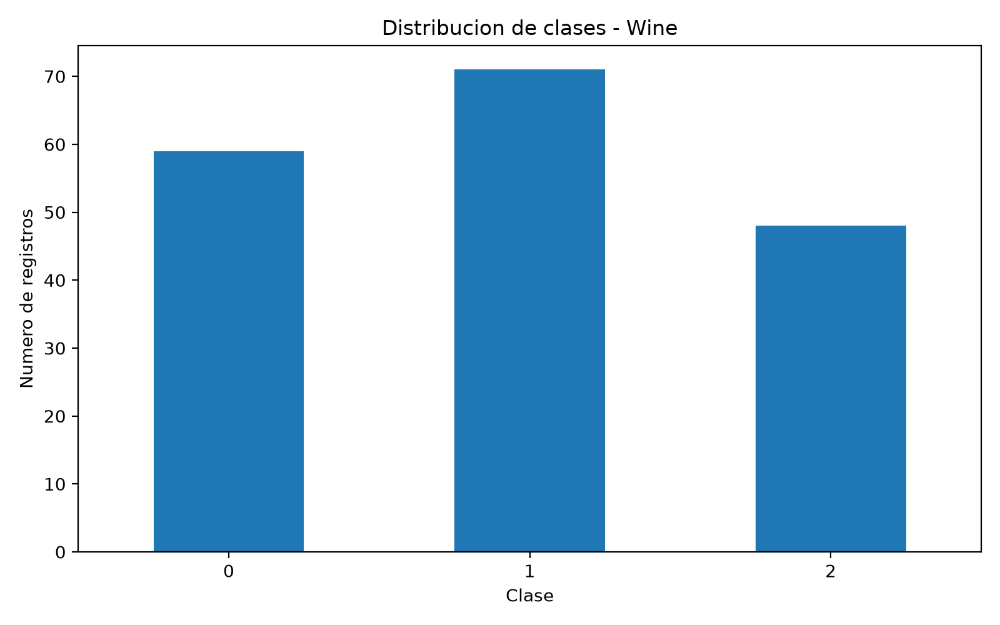
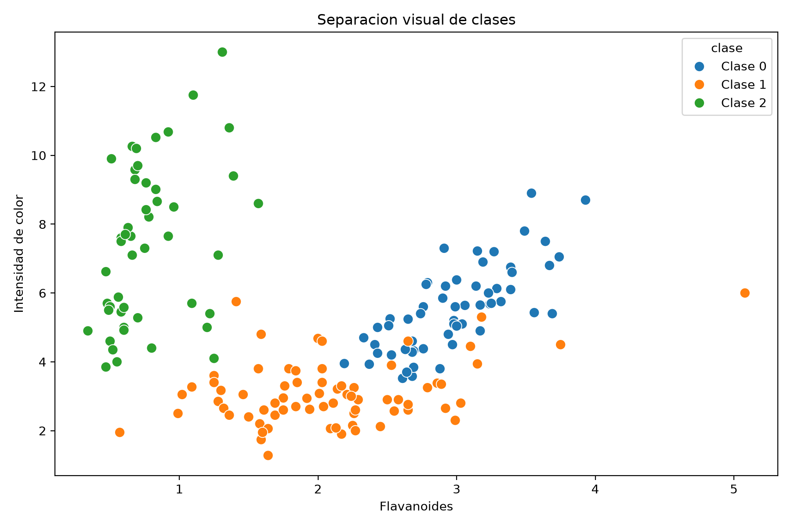
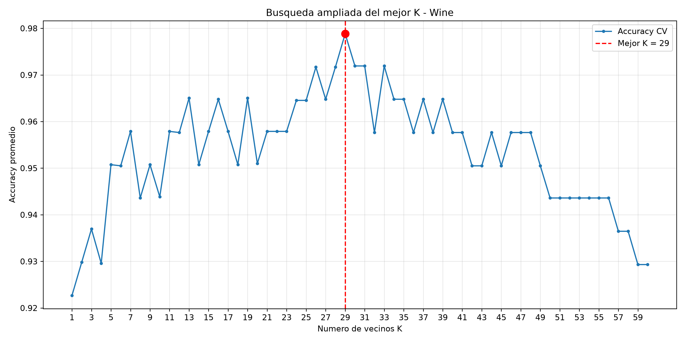
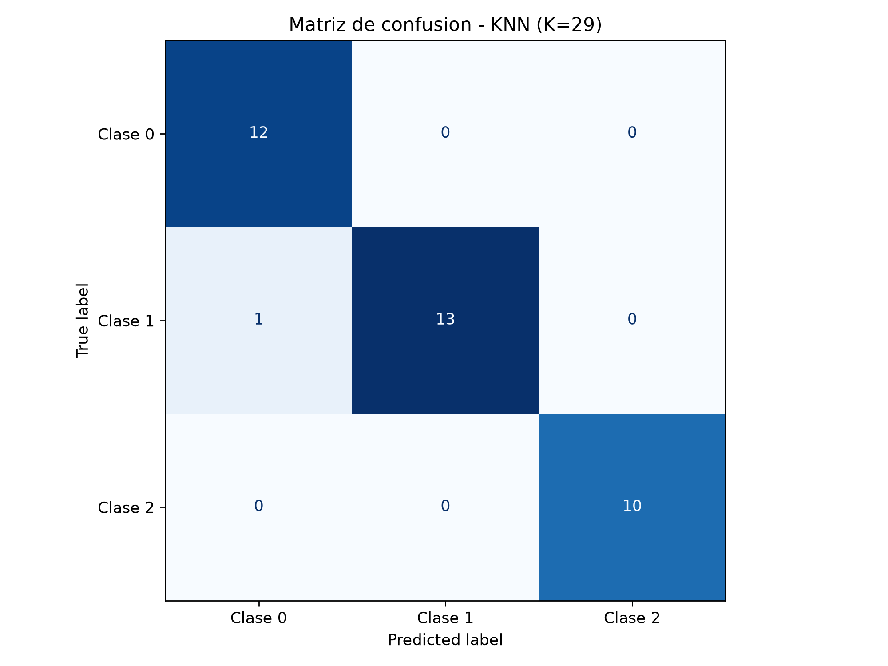

# Actividad 5 — Clasificación supervisada con KNN

**Maestría en Ciencia de Datos**

**Asignatura:** Fundamentos de Inteligencia Artificial

**Octubre de 2026**

## 1. Descripción

Implementación y evaluación de un clasificador
K-Nearest Neighbors (KNN) utilizando el conjunto
Wine Recognition.

El objetivo principal es seleccionar y justificar el
valor del hiperparámetro K mediante validación cruzada
y evaluar el rendimiento sobre datos no utilizados
durante el entrenamiento.

## 2. Dataset

**Fuente:** Wine Recognition Dataset, UCI Machine
Learning Repository, distribuido en scikit-learn.

Características:

- 178 observaciones.
- 13 variables predictoras numéricas.
- 3 clases.
- 0 valores faltantes.
- 0 registros completamente duplicados.

Distribución:

| Clase | Registros |
|---|---:|
| 0 | 59 |
| 1 | 71 |
| 2 | 48 |

Archivo: `data/wine.csv`

## 3. Metodología

1. Carga y exploración del dataset.
2. Análisis de integridad y distribución de clases.
3. División estratificada: 80% entrenamiento y 20% prueba.
4. Estandarización con StandardScaler dentro de Pipeline.
5. Validación cruzada estratificada de 5 folds.
6. Evaluación de K desde 1 hasta 60.
7. Selección de K por mayor accuracy promedio.
8. Entrenamiento final sobre 142 observaciones.
9. Evaluación sobre 36 observaciones independientes.
10. Predicción demostrativa de una observación sintética.

La semilla utilizada fue `random_state=42`.

El escalado se ajusta dentro de cada partición de
entrenamiento, evitando fuga de información.

## 4. Resultados

| Métrica | Resultado |
|---|---:|
| K seleccionado | 29 |
| Accuracy promedio CV | 97.88% |
| Desviación estándar CV | 1.73 puntos porcentuales |
| Accuracy en prueba | 97.22% |
| Balanced accuracy | 97.62% |
| Precision macro | 97.44% |
| Recall macro | 97.62% |
| F1-score macro | 97.43% |
| Aciertos | 35/36 |
| Errores | 1/36 |

### Matriz de confusión

```text
              Predicción
             0    1    2
Real 0      12    0    0
Real 1       1   13    0
Real 2       0    0   10
```

El único error corresponde a una observación
de clase 1 clasificada como clase 0.

K=29 fue el mejor valor observado dentro del
intervalo evaluado. No se afirma optimalidad
universal ni rendimiento garantizado en producción.

## 5. Gráficos

### Distribución de clases



### Separación visual



### Selección del hiperparámetro K



### Matriz de confusión



## 6. Reproducibilidad

Requisitos:

- Python 3.13.
- Git, opcional para clonar el repositorio.
- Dependencias de `requirements.txt`.

En PowerShell, desde la raíz del proyecto:

```powershell
python -m venv .venv

.\.venv\Scripts\python.exe -m pip install -r requirements.txt
```

Preparar y analizar datos:

```powershell
.\.venv\Scripts\python.exe .\src\01_preparar_datos.py
.\.venv\Scripts\python.exe .\src\02_eda_wine.py
```

Entrenar y seleccionar K:

```powershell
.\.venv\Scripts\python.exe .\src\03_entrenar_knn.py
.\.venv\Scripts\python.exe .\src\04_optimizar_k.py
.\.venv\Scripts\python.exe .\src\04b_verificar_k.py
```

Evaluación e inferencia:

```powershell
.\.venv\Scripts\python.exe .\src\05_evaluacion_final.py
.\.venv\Scripts\python.exe .\src\06_predecir_nuevo_vino.py
```

Ejecutar pruebas:

```powershell
.\.venv\Scripts\python.exe -m unittest discover -s tests -p "test_*.py" -v
```

### Notebook académico

El trabajo integrado se encuentra en:

`notebooks/Actividad_5_KNN_Wine.ipynb`

También se incluye una versión ejecutada con los
resultados y gráficos incorporados.

## 7. Predicción demostrativa

Se realizó una predicción con una observación
sintética de 13 características químicas.

Resultado: clase 0.

Los 29 vecinos votaron por la clase 0.

Esta observación no tiene etiqueta real conocida,
por lo que no constituye una evaluación adicional.

Las fracciones de votos de KNN no deben
interpretarse automáticamente como probabilidades
estadísticas calibradas.

## 8. Pruebas

El proyecto incluye seis pruebas automáticas:

- Integridad del dataset.
- División entrenamiento/prueba.
- Selección del hiperparámetro.
- Consistencia de métricas.
- Predicción nueva.
- Validación del notebook ejecutado.

Resultado de auditoría local: **6/6 PASS**.

## 9. Limitaciones

- Dataset relativamente pequeño.
- Solo 36 observaciones de prueba.
- Los resultados dependen del diseño experimental.
- La búsqueda de K estuvo limitada a 1–60.
- No se realizó una evaluación externa adicional.

## 10. Referencias

- UCI Machine Learning Repository — Wine Dataset:
  https://archive.ics.uci.edu/dataset/109/wine
- Scikit-learn — Wine Dataset:
  https://scikit-learn.org/stable/modules/generated/sklearn.datasets.load_wine.html
- Scikit-learn — KNeighborsClassifier:
  https://scikit-learn.org/stable/modules/generated/sklearn.neighbors.KNeighborsClassifier.html
